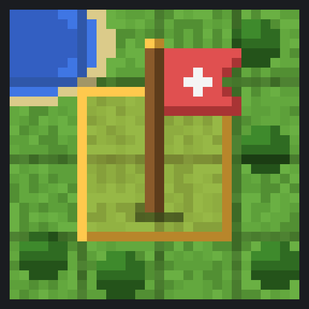

<p align="center">
  
</p>

<h1 align="center">Land Claims</h1>

<p align="center">
  Chunk claims, teams and chunk force loading for NeoForge.<br>
  Its own claim map, plus claim highlights on JourneyMap and Xaero's World Map.
</p>

<p align="center">
  <a href="https://github.com/Incoderr/Land-Claims/actions/workflows/build.yml"></a>
  <a href="https://github.com/Incoderr/Land-Claims/releases/latest"></a>
  
  
  <a href="LICENSE"></a>
</p>

<p align="center">
  <b>English</b> · <a href="README.ru.md">Русский</a>
</p>

---

## Features

- **Chunk claims.** Claim chunks for your team. Other players can't break or place blocks, open chests, doors or machines, touch item frames, armor stands or animals, or trample farmland.
- **Teams (clans).** Claims and force loading are shared by all members; invites, ownership transfer, a team color.
- **Chunk force loading.** Farms and machines in chosen chunks keep running with nobody nearby. Per-team limit and an "only while a member is online" mode.
- **Claim map.** A top-down screen with colors taken from block textures and tinted by biome, terrain shading and see-through water. Smooth zoom and panning, drag to select an area.
- **Team screen.** Members with skin heads and online status, one-click invites, a color picker for the team color.
- **Map integrations.** Claims are drawn in the team color on JourneyMap and Xaero's World Map when installed. On JourneyMap you can also claim and unclaim from the right-click menu of the fullscreen map. Neither map is required.
- **No easy workarounds.** Buckets, water and lava flowing across the border, pistons and explosions are handled.

## Requirements

| | Version |
|---|---|
| Minecraft | 26.3 |
| NeoForge | 26.3.0.100 or newer |
| Java | 25 |
| JourneyMap | optional, 26.3-6.0.11+ |
| Xaero's World Map | optional, 1.47+ |

The mod is required **on the server**. Clients need it for the claim map, the team screen and the map highlights. Players without the mod can still join: claims protect against them and limit them all the same, and they can manage claims with commands.

## Installation

1. Download `landclaims-<version>.jar` from [Releases](https://github.com/Incoderr/Land-Claims/releases).
2. Put it into the `mods` folder of the server and the clients.
3. Optionally install JourneyMap or Xaero's World Map.

## Usage

### Keys

| Key | Action |
|---|---|
| `G` | Claim map |
| `H` | Team screen |

Both can be rebound in Options → Controls → Land Claims.

### Claim map (`G`)

| Input | Action |
|---|---|
| Left click | Claim a chunk |
| Right click | Unclaim |
| Shift + left click | Turn force loading on |
| Shift + right click | Turn force loading off |
| Drag | Same action for a rectangular area |
| Mouse wheel | Zoom (towards the cursor) |
| WASD / arrows, middle mouse | Move the map, faster with Shift |
| Space, "◎" button | Back to your position |

Your team and other teams are shown in their colors. Force-loaded chunks have an inner frame and a dot in the middle. Claim and force-load counters are at the top.

The map is drawn from chunks your client has seen. While you walk around, the mod remembers explored land until you leave the world, so zooming out shows more than your render distance.

If you don't have a team yet, your first claim creates one named after you.

### Team screen (`H`)

- **Without a team:** create one or accept an invite.
- **In a team:** members (bright head: online, darkened: offline, ★: owner) and online players without a team you can invite.
- **The owner can:** invite, kick (✕), hand over ownership (★), rename, pick a color (presets or a full picker with HEX), disband the team.
- Leaving, disbanding and handing over ownership need a second click, so they can't happen by accident.

## Commands

### Claims

| Command | Description |
|---|---|
| `/claim` | Claim the chunk you are standing in |
| `/claim area <1-5>` | Claim a square of chunks around you |
| `/claim info` | Who owns the current chunk |
| `/claim list` | All claims of your team |
| `/claim forceload` | Force-load the current chunk |
| `/claim forceload off` | Stop force loading it |
| `/unclaim` | Unclaim the current chunk |
| `/unclaim all` | Unclaim everything your team owns (owner only) |

### Teams

| Command | Description |
|---|---|
| `/clan create <name>` | Create a team |
| `/clan invite <player>` | Invite a player (owner) |
| `/clan join <name>` | Accept an invite |
| `/clan leave` | Leave your team |
| `/clan kick <player>` | Remove a member (owner) |
| `/clan transfer <player>` | Hand over ownership (owner) |
| `/clan rename <name>` | Rename the team (owner) |
| `/clan disband` | Disband the team and remove all its claims (owner) |
| `/clan info [name]` | Team details |
| `/clan list` | All teams on the server |

Team names are 2 to 16 characters: Latin letters, digits, `_` and `-`. The command is `/clan` because `/team` is taken by vanilla scoreboard teams.

### Admins (permission level 2+)

| Command | Description |
|---|---|
| `/claim admin bypass` | Toggle ignoring claims for yourself |
| `/claim admin unclaim` | Remove any claim from the current chunk |

## Configuration

`config/landclaims-synced.toml` on the server. Values are sent to clients automatically.

| Option | Default | Description |
|---|---|---|
| `maxClaimsPerTeam` | `100` | How many chunks one team can claim |
| `maxForceLoadedPerTeam` | `25` | How many of them can be force-loaded |
| `protectFromExplosions` | `true` | Explosions don't break blocks in claims |
| `forceLoadOnlyWhileOnline` | `false` | Keep a team's chunks loaded only while one of its members is online |

## Not protected yet

- Dispensers pouring fluids or placing blocks across a claim border.
- Endermen moving blocks.
- Machines from other mods that break blocks as a "fake player".

## Development

Requires Java 25; Gradle downloads everything else.

```sh
./gradlew build        # build and test, jar in build/libs
./gradlew test         # tests only
./gradlew runClient    # client as Dev
./gradlew runClient2   # second client as Dev2, for testing with two players
```

**Two players locally:** create a world in the first client and open it to LAN (Esc → "Open to LAN"); the second client joins through Multiplayer.

Dev runs include JourneyMap. To test Xaero's World Map instead, swap the commented `localRuntime` lines in `build.gradle`.

### Layout

| Path | Contents |
|---|---|
| `data/` | Teams, claims and force loading, saved with the world |
| `ClaimProtection`, `mixin/FlowingFluidMixin` | Claim protection |
| `ClaimService`, `TeamService` | Player actions shared by commands and screens |
| `ForceLoadManager` | Chunk loading tickets |
| `network/` | Client sync and requests from the screens |
| `client/screen/` | Claim map, team screen, color picker |
| `client/map/` | Chunk rendering for the map |
| `client/journeymap/`, `client/xaero/`, `mixin/xaero/` | Map integrations |

## License

[MIT](LICENSE)
